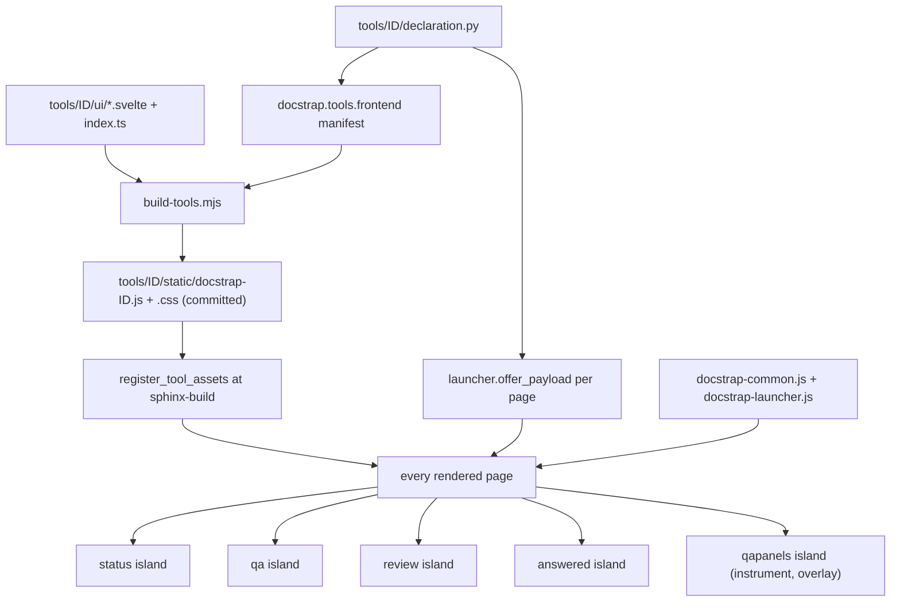
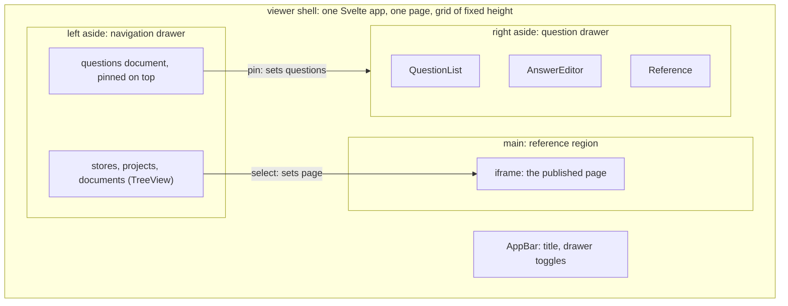
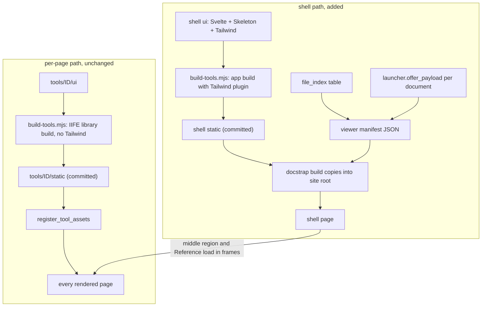

# 0004 — A viewer shell: the question panels in a drawer, the compendium in the middle

Written 2026-10-04, answering the captain's ask of the same day: *"The bottom section has no scroll
bar. A better design: put all 3 question panels in a side drawer component on the right. Keep the
navigation in a side drawer on the left. Put the questions document in the list of files and projects
docstrap has in the nav drawer at the top. It stays open in the questions tool on the right drawer
while the docstrap compendium of docs can be used to reference documentation in the middle viewing
area. The docstrap viewer should be using a svelte based app layout, based on a shell that is from
Skeleton."*

**The ask moves the viewer from per-page islands to an application, and the scroll bar is the symptom
that shows why.** Six facts, each checked against the working tree, the npm registry or Skeleton's own
documentation on 2026-10-04. The third was not expected, and it changes what "fix the scroll bar"
means:

1. **The viewer today is not an application.** It is five Svelte islands injected into every page
   Sphinx renders. Each tool under `src/docstrap/tools/` that has a `ui/index.ts` is compiled by
   `build-tools.mjs` into one self-contained IIFE bundle carrying its own tree-shaken copy of the
   Svelte runtime, and `register_tool_assets` adds every one of them to every page. As committed, the
   five bundles weigh 168.6 kB of JavaScript and 15.7 kB of CSS on each page view: `answered` 31.2 kB,
   `qa` 30.0 kB, `qapanels` 47.5 kB, `review` 32.3 kB and `status` 27.6 kB of script.
2. **The three-panel mode is one of those islands.** `qapanels` is declared `Kind.INSTRUMENT`, but it
   ships with every page like a tool and opens as a `position: fixed; inset: 0` overlay over the page
   that launched it. `Panels.svelte` stacks its three panels vertically at fixed proportions: the
   question list at `28vh`, the answer editor at `22vh`, and the rendered document — `Reference.svelte`,
   an `<iframe>` of the published page — taking what is left at the bottom.
3. **The bottom section's missing scroll bar is a visibility leak, not a layout fault, and a shell would
   inherit it.** Read from source first, then reproduced in a browser (§11): visibility state lives
   in `localStorage` under `docstrap:tool-visibility`, which the reference frame shares with the page
   that launched the panels because both are the same origin. When the framed page loads, the launcher
   calls `docstrap.tools.start()`, which reads `qapanels: true` from that shared store and calls
   `setVisible('qapanels', true)`. `setVisible` toggles the body class **before** it calls the
   handler, so the frame's `<body>` gains `docstrap-show-qapanels` even though the handler itself
   declines to mount inside a frame. `qapanels.css` then applies its scroll lock —
   `body.docstrap-show-qapanels { overflow: hidden }` — to the document in the reference panel. The
   chrome suppression `Reference.svelte` injects hides `.docstrap-chrome` and does nothing about the
   body class. The bottom panel therefore shows a document that cannot scroll. A shell whose middle
   region is a framed docstrap page meets exactly the same leak, which is why §3 treats overflow as a
   requirement and not as a patch.
4. **Skeleton is not a dependency anywhere in this package**, and the current major does support the
   Svelte 5 and Vite 6 pair the package is on. §6 has the registry findings. The part worth stating up
   front is that **Skeleton 5 ships no shell component**: the `AppShell` component existed in
   `@skeletonlabs/skeleton` 2.11.0 and is absent from `@skeletonlabs/skeleton-svelte` 5.0.1, whose
   documented answer to "app layout" is a guide to semantic HTML and Tailwind grid. "A shell from
   Skeleton" today means that guide composed with Skeleton's components; as built, the shell uses its
   `AppBar` and `TreeView`.
5. **The project's own rules already permit this.** `docs/tools-and-instruments.md` §1.1(2) says
   Skeleton is for instruments only, because an instrument owns its own view and a tool renders inside
   a page whose styling Sphinx and furo own. A shell is an instrument by §1's boundary test — the
   standard document view is replaced — so adopting Skeleton for it is inside the existing rule rather
   than an exception to it.
6. **The decision-backlog proposal does not settle any of the rulings this one must take a position
   on.** `docs/proposals/0003-clearing-the-decision-backlog.md`, which landed on `main` while this was
   being written, rules on twenty-one questions from
   three holds. None of them is `docstrap-tool-weight-h35`, and none is either of the two panel rulings
   from the multipanel diagnostic. Its §6.1 is about tag indexes, backlinks and feeds on aggregate
   pages, which is a different question from whether aggregates should offer project-targeted
   apparatus. So §8 below states this document's own standing on all three, and cites nothing as
   already settled. One finding of that proposal is used here: its §6.10 records that a build counts
   Sphinx's warnings and discards their text, which is why this document's verification captured the
   text separately.

**The design was approved on 2026-10-04 and built the same day.** It still sits in `proposals/`; the
folder carries the weight (repository `AGENTS.md`), and moving it to `plans/` is the captain's act
rather than part of the change that implemented it. Its open questions at the end are still open. §11
records what was built where it differs from the sections above, and what a browser run saw.

## §1 What the viewer is today

### §1.1 The build-and-inject path

A tool's client source is Svelte under its own `ui/` directory. `docstrap.tools.frontend` reads the
declarations and prints a manifest naming each tool's entry module, output directory and the two bundle
filenames its declaration derives; `build-tools.mjs` runs one Vite library build per entry and writes the
result into the tool's own `static/`, where it is committed so that installing docstrap needs Python
only. At Sphinx time each tool's `setup(app)` calls `register_tool_assets`, which adds the shared
`docstrap-common.js` and then that tool's bundle to **every page of the build**. The page also carries
its offers — the tools valid where the reader stands, with their API URLs already resolved — as JSON in
the head, computed in Python by `docstrap.tools.launcher`.

Two properties of that path matter to everything below. The client never assembles an API path: a tool
asks `docstrap.tools.route(id)` and gets back the URL the declaration resolved for this page. And a
tool's visibility is owned by `window.docstrap.tools`, not by the tool and not by the launcher, so that a
second control could drive it without either becoming the owner — `docs/tools-and-instruments.md` §3
named "a three-panel mode later" as that second control.

### §1.2 What an instrument is under that path

The path was built for tools, and an instrument rides it unchanged. `qapanels` registers `show` and
`hide` with the launcher; `show` appends a root to `<body>` and mounts `Panels.svelte` into it, and the
component's own styles make it a fixed full-viewport overlay at `z-index: 2147483000`. The page beneath
is still loaded and still scrolled to wherever it was; the body class from the declaration's
`visibility_class` locks its scrolling while the overlay is up.

The reference panel is the published page loaded again in an `<iframe>`, which is the right decision
and is kept below: it means no second renderer and nothing to keep in step. Two guards make that frame
behave. `index.ts` registers no-op handlers inside a frame so the mode cannot open inside its own
reference panel, and `Reference.svelte` injects a style hiding `.docstrap-chrome` once the frame loads.
Neither guard covers the body class, which is fact 3.

### §1.3 Why the islands are the wrong shape for this ask

The ask wants two things the island model cannot express. It wants **a navigator** — every project and
document docstrap has, in one list — and no page knows that list; each knows its own project at most.
And it wants **two independent contexts on screen at once**: the document whose questions are being
answered, which must stay put, and the document being read for reference, which must move freely. An
island lives inside one page and dies when that page is left, so the moment the reader navigates for
reference the panels are gone. Keeping them requires something that outlives navigation, which is what
an application shell is.

## §2 The shell — three regions on one page

**docstrap is a workstation tool for developers on a monitor approaching 4K, with a large-screen tablet
as a secondary target that the same layout happens to serve.** It is not a tool with a responsive range.
A large tablet has desktop-class screen space, so it is not a narrow-width case: the three regions fit
side by side there exactly as they do on a monitor, and the shell has one width class that covers both.
There is no phone audience and no small-screen path, and nothing below plans a breakpoint or a degraded
layout. Desktop Safari is a minor consideration; Safari on a phone is not one at all. The tablet is
best-effort: it is tested where convenient and never blocks delivery.

**Touch is kept in view as an input method**, because a tablet has no pointer. Three things follow, none
of which changes the layout. The shell's own hit targets — tree rows, the pin control, the drawer
toggles — are sized for a finger rather than for a cursor; the hosted panels keep their own sizes. No
affordance exists only on hover: the pin control on a tree row is always visible, not revealed by
hovering the row. And each region's scrolling is the browser's own native overflow scrolling, which a
finger drives inside each region without any gesture code of the shell's. Where a Skeleton component is
used, its interaction comes from the zag.js state machine underneath it, which handles pointer input
whether the pointer is a mouse or a finger, so the shell does not design around it.

**On a tablet the shell declares a landscape preference; it does not build a portrait layout.** The
three regions need width, landscape supplies it, and portrait gets a preference expressed rather than an
alternate layout. What a page can actually do here is limited, and the limit falls hardest on the device
this is for. A real orientation lock through the Screen Orientation API requires fullscreen on the
browsers that implement it and is not available in iOS Safari at all, so a lock would silently do nothing
on exactly the target that motivates it; none is attempted and none is claimed. What works is a declared
preference with an honest fallback: a CSS orientation media query, and in portrait a single readable
message saying the shell wants landscape, laid over the shell rather than reflowing it into a cramped
three-column layout or collapsing it into panels nobody asked for. The query is
`(orientation: portrait) and (pointer: coarse)` rather than orientation alone, because orientation is
the viewport's aspect and not the device's: a desktop window that happens to be taller than it is wide
is portrait too, and the workstation target must never see the message. A web app manifest's
`orientation` field would be a second expression of the same preference, honoured by browsers only in
installed contexts — but no docstrap build emits a web app manifest, so there is nowhere to set it today,
and adding a manifest for this alone is not proposed. The preference is a secondary target's, which the
platform may or may not honour, and it never reshapes the primary layout.

### §2.1 The layout

One Svelte application on one page of its own, laid out per Skeleton's layout guide as semantic regions
on a CSS grid: an `AppBar` across the top, an `<aside>` on the left for navigation, `<main>` in the
middle, and an `<aside>` on the right for the question panels.

### §2.2 The left drawer: projects, documents, and the questions document on top

The drawer lists every registered store's projects and, under each, its documents. Because a document's
identity is its **path** below `docs_root` — `proposals/0002-the-upgrade-path` — and nested is the
normal case (666 of 686 published pages at the time of the path-routing repair), the documents are a
tree rather than a flat list. Skeleton's `TreeView` is the primitive for that, and the tree's shape
comes from the path itself rather than from any slugified name, which the project's rules forbid.

Above the tree, in its own labelled group, sits **the questions document**: the one document whose
questions the right drawer is answering. It is a pin, not a selection. Selecting a document in the tree
changes what the middle region shows; pinning a document makes it the questions document and changes
what the right drawer shows. Reading the ask literally, it is one document at a time, and it appears in
the list at the top because it is the thing the reader is working on while everything below it is
reference.

A store's or project's landing page appears as the node for that store or project, so the composed
section pages and aggregate pages stay reachable. Those pages have no project of their own, and §8.2 is
how the shell treats that.

### §2.3 The middle region: the published page, in a frame

The middle region renders the selected document by loading its published page in an `<iframe>`, for
three reasons that each stand alone.

First, it is the precedent `Reference.svelte` already set: what is read is exactly what is published, by
the renderer that published it, with nothing to keep in step. A shell that rendered documents itself
would be a second renderer of MyST, which nothing in docstrap wants to own.

Second, a frame is a separate document, so **Tailwind and Skeleton cannot touch furo's styling, and
furo cannot touch the shell's.** That is the collision `docs/tools-and-instruments.md` §1.1(2) cites as
the reason tools may not use Skeleton. Inside a frame the collision is impossible by construction rather
than avoided by care: Tailwind's preflight reset lives in the shell's document and the page's styles live
in the page's.

Third, the page in the frame is the real page, so whatever per-page tools it carries are the real tools
running in their normal environment. Whether they should be live there is Q2.

Links followed inside the frame navigate the frame. The middle region learns where the frame went from
its `load` event, reading the framed page's location — same origin, so readable — and the shell moves
the tree's highlight to match. That is the only thing the middle region reports upward, and it never
reaches the right drawer.

**The middle region is a component of its own, `DocumentView.svelte`, and it owns the frame.** The
requested page, the frame's loading, its failures and the framed document's scrolling all live there,
so the shell root holds layout and state and nothing about loading documents. Its failures are two and
it keeps them apart. A requested page is checked with one `HEAD` request before the frame is pointed at
it, because only a request can tell "docstrap answered, and has no such page" from "nothing answered" —
a frame reports both as a load event. A page reached by a link inside the frame was never requested,
so its own navigation entry is read for the status it arrived with. Both are worded by
`describeApiFailure` (§8.3).

### §2.4 The right drawer: open state independent of the middle region

The shell's root component owns two pieces of state and nothing couples them:

1. **`questions`** — the pinned questions document: its project, its document identity, and its
   resolved `qapanels` routes. Only pinning changes it.
2. **`page`** — the URL in the middle region. Selecting in the tree, or following a link in the frame,
   changes it.

The right drawer is bound to `questions` and to its own open flag, and to nothing else. Navigating the
middle region therefore cannot close it, re-read it, or reset its selection, because nothing the
navigation touches is anything the drawer reads. That is the ask's "it stays open in the questions tool"
stated as a property of the state graph rather than as a behaviour someone has to remember to preserve.

**Collapsing the drawer hides it; it does not unmount it.** The difference is load-bearing.
`AnswerEditor` holds the text being typed and a pending autosave timer, and `Panels` holds the selected
question and the scope; unmounting would discard all of it, and remounting would re-read the listing and
land the reader back at no selection. So the drawer's open flag drives visibility and width, and the
`Panels` instance stays alive for the whole life of the shell page.

**The right drawer is not a modal.** Skeleton's `Dialog` is the drawer primitive it ships, and a modal
dialog traps focus and makes the rest of the page inert. That is precisely wrong for a drawer whose
purpose is to be answered *while* the middle region is read. The right drawer is a persistent grid
column, and so is the left drawer.

Both pieces of state are also written to the shell's own URL — the questions document in a query
parameter, the middle page in the fragment — so a reload restores both, and so the two stay two fields
there as well.

## §3 Each region owns its overflow

The missing scroll bar is answered as a design requirement: **every region scrolls within itself, and
the page never grows.** The shell root is exactly the viewport's height with its own overflow hidden;
each grid region is `min-height: 0` with its own vertical overflow, so a long tree scrolls inside the
left drawer, a long question list scrolls inside the right drawer, and the document scrolls inside the
frame. No region's content can push another region off the screen, because no region's content is
allowed to size the grid.

### §3.1 Inside the right drawer

The same rule applies one level down. The drawer is a column of three panels, and each owns its overflow
the way each region does: `QuestionList` already sets `overflow-y: auto; height: 100%`, the answer
`<textarea>` already scrolls its own text, and `Reference` is a frame that scrolls its own document —
once the frame's document is allowed to scroll, which is §3.2. What changes is only who sizes the
panels: today `Panels` gives them `28vh` and `22vh` of the viewport, and in a drawer they take shares of
the drawer instead. §4 is how that is done without rewriting `Panels`.

### §3.2 A framed page must not inherit an instrument's scroll lock

Fact 3 applies to every frame in the design — the middle region and the `Reference` panel both. Three
places could stop it, and they are not equal.

1. **Scope the lock to the overlay actually being on the page.** `qapanels.css` is the one rule that
   locks scrolling, and it can say what it means: lock the body only when it holds the mounted panels
   root, `body.docstrap-show-qapanels:has(> .docstrap-qapanels-root)`. A framed page has the class and
   never has the root, so it scrolls. This touches only the instrument's own stylesheet, not a shared
   asset, and it repairs the existing overlay mode in the same act.
2. **Have `docstrap-common.js` apply no instrument visibility inside a frame.** Correct in effect, but
   it changes a shared static asset every page depends on, to serve one instrument's case — the shape
   `docs/tools-and-instruments.md` §4 says means the design is wrong.
3. **Have the shell inject an override into every frame**, the way `Reference` injects its chrome
   suppression. It works, and it is a third place patching around a rule instead of the rule being
   right.

**The recommendation is the first.** It is the smallest, it lives with the rule it corrects, and it is
independent of the shell, which is why it is the first step in §9 and why Q4 asks whether it should land
on its own.

### §3.3 This departs from Skeleton's own layout advice, deliberately

Skeleton's layout guide says to "prioritize the `<body>` element as the scrollable page element over
child elements". The ask's requirement and that advice cannot both be met, and the requirement wins for
a structural reason: body scroll means one scroll context for the whole page, and this page has three
contexts that must move independently — the navigator, the document, and the answer being written. The
middle region is a frame besides, and a frame's document never scrolls with its parent's body whatever
the parent does. The guide's concern for print is moot here: what anyone prints is the published page,
which is a plain page and prints as one.

The one place this departure bites is the secondary target. Safari on a large tablet is where the
guide's body-scroll advice matters in practice: with the body never scrolling, Safari's toolbar does not
collapse as the reader scrolls, and a pull at the top of a region scrolls that region rather than
reloading the page. That is recorded as a **known limitation of the tablet target**, not as a cost the
workstation target pays, and it does not reopen the decision — three regions must scroll independently,
so the body cannot be the scroll element on any device.

## §4 Reusing the qapanels components rather than rewriting them

`QuestionList.svelte`, `AnswerEditor.svelte` and `Reference.svelte` are hosted as they are. Each already
fills whatever box it is given and scrolls inside it, so none needs to know whether that box is a slice
of a full-viewport overlay or a slice of a drawer.

`Panels.svelte` is also hosted rather than replaced, because it is where the answer loop's orchestration
lives: reading the listing, holding the selection across a reload, flushing the outgoing answer on every
context change, saving drafts and submissions, choosing the scope, and wording failures. Composing the
three children directly in the shell would mean writing that orchestration a second time, and the
project's experience with second implementations — a second slug function, a second answers writer —
is that they drift and orphan data. What `Panels` needs is three seams, each small, and each leaves the
per-page overlay behaving exactly as it does now — plus one exported `flush()`, so a host about to
replace it can save the pending answer first, the way switching question or scope already does.

1. **Placement moves to the host.** `Panels` hard-codes `position: fixed; inset: 0` and its `z-index`.
   That is a fact about where the overlay is mounted, not about the panels, and it belongs to the host
   that mounts it: the per-page `index.ts` already creates `.docstrap-qapanels-root`, and `qapanels.css`
   already has a rule for that root. In the shell the drawer is the host, and the panel proportions
   become shares of the host's height rather than of the viewport's.
2. **The reference base is supplied, not inferred from `window.location`.** `Panels.projectBase()`
   strips the current page's document slug off the current URL to find where its sibling pages are. In
   the shell, `window.location` is the shell's URL and that inference is wrong. An optional prop
   carrying the base, defaulting to today's derivation, keeps the overlay unchanged and gives the shell
   the URL its manifest resolved (§5.1).
3. **The `DocstrapGlobal` it is handed describes the questions document.** This one changes nothing in
   `Panels`; it is what the shell hands it. `Panels` reads
   `d.tools.route('qapanels')`, `d.tools.altRoute('qapanels')`, `d.ctx.docSlug`, `d.api` and
   `d.silenceOfflineError`. The shell page loads `docstrap-common.js` unchanged, so `api` and
   `silenceOfflineError` are the real ones; the shell hands `Panels` a view of that object whose `ctx`
   and routes are the pinned document's, taken from the manifest where Python resolved them. The rule
   that the client never assembles a path holds: choosing a questions document in the shell is choosing
   a manifest entry, the same way choosing a scope in `Panels` is choosing between two resolved URLs.

`Panels`' `Close` button and its `Escape` handler call the `onclose` it is given, which in the overlay
turns the instrument off; in the shell, `onclose` collapses the drawer, and per §2.4 collapsing flushes
nothing away.

## §5 Where the shell's data and files come from

### §5.1 The navigator's data: a manifest the build writes into the site

The shell needs, for every store, project and document: a title, the document identity, the published
page's URL, and the `qapanels` offer with its routes resolved. The proposal is that the build writes this
as one JSON file into the site it publishes, composed from what the build already knows: the
`file_index` table says what each published directory contains (`docs/spec.md` §5.2, and
`sectionindex.compose` already answers section pages from it without touching a filesystem), and
`launcher.offer_payload` is the function that already resolves a page's offers — called here once per
document with the same `PageContext` the page itself gets. So the URLs in the manifest are the URLs in
the pages, by construction, from one function.

This stays inside the project's build rules. It is JSON, not markdown, so the rule that no build
produces markdown is untouched. It is written into the build output and nowhere else, so a build still
writes nothing into a project. And it is a build output like the HTML beside it, not a cache, so the rule
against adding invalidation or staleness checks is untouched too: the next build rewrites it.

**The alternative is a server endpoint, and it is weaker.** The server is handed only a site root and
does not know which store slug the build chose for which subdirectory; it would have to recompute what
the build already decided, which is a second owner of the site's layout. A static manifest also has a
property worth keeping: the navigator and the middle region then work from any static host, and only the
right drawer needs `docstrap serve`. That draws the line between "the site" and "the server" at exactly
the place §8.3's ruling is about.

### §5.2 The shell's own files: a second kind of build target, not a tool

The shell is built by `build-tools.mjs`, from its own Svelte source into its own committed `static/`,
the same way tool bundles are, so installing docstrap still needs Python only. It is **not a
`ToolDeclaration`**, and that is deliberate. A declaration means per-page assets registered by
`register_tool_assets` and a Sphinx extension; the shell has neither, and declaring it would put Skeleton
and Tailwind on every documentation page — the per-page cost an instrument is supposed to avoid and the
styling collision §1.1(2) forbids. `docstrap.tools.frontend` gains one entry describing the shell's
source and output, so the Node side still spells no path.

The shell's build differs from a tool's in kind: an application build with Tailwind's Vite plugin, not
an IIFE library build. The plugin must be scoped to the shell's build only. Tool stylesheets are read by
people reviewing what a tool draws on a page, they are deliberately left unminified for that reason, and
they must come out byte-identical to what is committed today. That is the check §9(4) puts on the step
that introduces Skeleton.

The build copies the shell's committed files into the site root once — at the outermost level, the
super-aggregate in a multi-store build or the store root in a single-store one — beside the manifest.

### §5.3 The Python surface this touches, and what it leaves alone

Touched: the build, which writes the manifest and copies the shell's files, and
`docstrap.tools.frontend`, which describes one more build target. That is what injecting a new shell
requires and nothing more.

Left alone: `server.py`; `docstrap.answers` and the answer store's format; `docstrap.questions` and the
`Q<n>` numbering contract; the question export format; `register_tool_assets` and every declaration;
`docstrap-common.js` and `docstrap-launcher.js`; and every per-tool bundle.

## §6 What adopting Skeleton commits the package to

### §6.1 The registry, as read on 2026-10-04

| package | current | peer requirements | this package has | satisfied |
|---|---|---|---|---|
| `@skeletonlabs/skeleton` | 5.0.1 | `tailwindcss ^4.0.0` | none yet | with Tailwind 4 |
| `@skeletonlabs/skeleton-svelte` | 5.0.1 | `svelte ^5.40.0` | `svelte` 5.56.10 | yes |
| `tailwindcss` | 4.3.3 | none | none yet | — |
| `@tailwindcss/vite` | 4.3.3 | `vite` `^5.2.0`, `^6`, `^7` or `^8` | `vite` 6.4.3 | yes |
| `@lucide/svelte` | 1.51.0 | `svelte ^5` | `svelte` 5.56.10 | yes |

**The finding is that the current Skeleton major supports the Svelte 5 and Vite 6 pair.** Skeleton's
Svelte package declares no Vite requirement of its own; Vite enters through Tailwind's plugin, which
accepts Vite 6. The installed versions are read from the committed `package-lock.json`, so no Svelte or
Vite change is needed and none would be proposed — if the answer had been otherwise, the right response
would have been to stop rather than move Svelte to fit a shell. `@sveltejs/vite-plugin-svelte` stays at
the 5.1.1 the lock already resolves.

### §6.2 What arrives with it

Adding Skeleton is four direct development dependencies — the two Skeleton packages, `tailwindcss` and
`@tailwindcss/vite` — plus `@lucide/svelte` for icons, imported by deep path so the bundle tree-shakes.
Underneath, `@skeletonlabs/skeleton-svelte` 5.0.1 carries thirty-one runtime dependencies: twenty-nine
`@zag-js/*` state-machine packages pinned exactly at 1.43.0, `@internationalized/date`, and
`@skeletonlabs/skeleton-common`. Tailwind 4 brings its native `@tailwindcss/oxide` engine, which is a
platform-specific binary. All of it is a development dependency of changing the shell's UI, in the same
category Node already is, and none of it is a dependency of installing or running docstrap.

It would be added through `npm install`, never by editing `package.json`, so the resolved versions and
peers are written against the live registry into both `package.json` and `package-lock.json`.

### §6.3 What owning it costs

**Churn is the real cost.** Skeleton's majors have come quickly: 3.0.0 on 2025-03-11, 4.0.0 on
2025-10-13, 5.0.0 on 2026-07-17 — three majors in sixteen months, and somewhere between 2.11.0 and 5.0.1
the `AppShell` component the ask's wording recalls went away. Each major is a migration of whatever the shell
uses. The mitigation is to use little of it: the layout is the guide's plain grid, which no Skeleton
release can remove, and the components the shell leans on — `AppBar` and `TreeView` — are thin
wrappers over zag.js machines whose behaviour is stable even when Skeleton's API is
not.

**Tailwind becomes part of the Node build.** Until now `build-tools.mjs` knew one kind of build; it
would know two, and the second one is Tailwind-aware. §5.2's byte-identical check on the tool bundles is
what keeps the first kind from noticing.

**The weight stays off ordinary pages.** The shell's bundle loads on the shell's page only. A reader of
an ordinary documentation page pays nothing for Skeleton, Tailwind or zag.js.

## §7 The per-page tools keep working beside the shell

The shell is an addition, and the per-page path in §5.2's diagram keeps the same declarations, the same
`register_tool_assets`, the same `docstrap-common.js` and launcher, and the same five bundles. Since
2026-10-12 those scripts run only inside the shell: a page opened on its own runs one small button that
opens it there (`docs/tools-and-instruments.md` §3.2), so the status badge, the review marks and the
answer form work on a page in the middle region and not on a page opened directly.

The `qapanels` overlay keeps working too. §4's three seams are written so that the overlay's behaviour
is unchanged, and §3.2's scoped lock changes the overlay only by fixing its reference panel. Whether the
overlay should eventually give way to the shell is not this document's question; the ask makes the shell
an addition, and that is how it is planned.

Inside the shell, the pages in the middle region and in `Reference` are ordinary pages and carry their
tools. Whether those tools should be live there or suppressed as chrome is Q2. How a reader on an
ordinary page gets into the shell — by its URL alone, or by an offer in the launcher — is Q3.

## §8 Standing on the three open rulings

### §8.1 `docstrap-tool-weight-h35` — the runtime cost is accepted

h35 asks whether to cut the per-page Svelte runtime cost or to accept it deliberately. **This proposal's
standing is that it is accepted.** An application shell is itself a Svelte runtime on a page of its own,
and each page it frames still loads every per-tool bundle with its own runtime copy, so building the
shell is choosing the Svelte runtime as the viewer's foundation rather than trimming it. Proposing the
shell while leaving h35 open would be proposing two incompatible directions at once.

Accepting the cost is not foreclosing the lever. `docs/tools-and-instruments.md` §5.2 names ES-module
bundles sharing one runtime chunk as the obvious next step for the per-page path, and nothing in the
shell prevents taking it later. What accepting h35 means is that the shell does not wait for it and is
not a reason to do it. `0003-clearing-the-decision-backlog` does not rule on h35, so this is not a
citation of a ruling but a position this document takes; it becomes the captain's answer only if the
captain says so.

### §8.2 Whether aggregate pages should stop offering project-targeted apparatus

Today a store's landing page and the super-aggregate carry no project, so `launcher.is_valid_here`
already declines every project-targeted offer there; the open ruling is whether to make that a stated
rule about aggregates — offering no apparatus at all there — rather than a consequence of their having no
project. **The shell adds no rule of its own about it.** Its manifest's offers come from
`launcher.offer_payload`, which applies `is_valid_here`, so an aggregate node in the tree has exactly the
offers an aggregate page has, which today is none that needs a project. If the ruling tightens the rule,
the manifest follows on the next build. If it loosens it, the manifest follows that too. The only thing
the shell decides is that an aggregate can never be pinned as the questions document, and it decides
that by having no `qapanels` offer to pin, not by a test of its own.

### §8.3 Whether the panel layer should distinguish a server 404 from no server

This is the failure that once turned an hour of work into a day, and the shell must not make it worse.
**The shell adds no third way of describing a failure.** The `Panels` it hosts already words every read
and write failure through `describeApiFailure` and `apiStatus` in `sphinx/ui/docstrap.ts`, which the
project's rules make the only place allowed to say `docstrap serve` is not running; the shell's own
manifest read goes through the same function.

§5.1's static manifest sharpens the ruling's subject rather than blurring it. With the navigator and the
middle region needing no server, the right drawer is the only place in the shell where "the server
answered 404" and "nothing answered" can arise at all — which is exactly the panel layer the ruling is
about. One residual is named rather than changed: `docstrap-common.js`'s `silenceOfflineError` treats a
404 and an absent server the same way, by staying quiet, and `Panels` calls it. Whichever way the ruling
goes, it changes that function and `describeApiFailure`, and the shell inherits the answer through the
`DocstrapGlobal` it hands to `Panels` without any change of its own.

## §9 Ordering

Five steps, in this order, each independently verifiable.

1. **Scope the scroll lock** (§3.2, the first option). It is independent of everything else, it is a
   few characters in the instrument's own stylesheet, and it fixes the bottom panel the captain reported
   in the mode that exists today. Q4 asks whether it should land alone.
2. **Open the three seams in `Panels`** (§4), with the overlay's behaviour unchanged. This is where a
   regression would show in the existing mode, so it is verified there before anything hosts `Panels`
   anywhere else.
3. **Write the manifest** (§5.1). Python only, testable without a browser: every document in the
   manifest has the URL its page has, and every `qapanels` route in it equals the route its page
   carries.
4. **Add Skeleton and build the shell** (§5.2, §6), with the check that every per-tool bundle rebuilds
   byte-identical to what is committed.
5. **Drive it in a browser at a workstation width**, and report what was seen: the left drawer lists projects
   and documents with the questions document at the top; selecting a document changes only the middle
   region; the right drawer stays open, with its selection and unsaved text, across that navigation; and
   every region — the tree, the frame, and each of the three panels — scrolls inside itself while the
   page does not grow. The browser
   blockers recorded in `docs/tools-and-instruments.md` §7 have to be cleared or worked around first,
   and a sample project with nested documents is required, for the reason that section gives.

## §10 What this forecloses

Four things, each accepted.

1. **A single kind of frontend build.** `build-tools.mjs` gains a Tailwind-aware application build
   beside its library builds. The byte-identical check of §9(4) keeps the two from interfering, and it
   is a check somebody has to keep running.
2. **Freedom from a fast-moving dependency.** Three Skeleton majors in sixteen months means the shell
   will be migrated, probably more than once. §6.3's mitigation — a plain grid and a few thin components
   — limits the size of each migration and does not remove the obligation.
3. **Styling documents from the shell.** The frame that keeps Tailwind and furo apart also means the
   shell cannot restyle a document to match itself; a page reads in the middle region exactly as it
   reads on its own. That is the point of the frame, and it is still a door closed.
4. **A shell on a different origin from the site.** The shell reads each framed page's `docstrap.ctx`
   and `Reference` already writes into its frame, both of which need the same origin. Serving the shell
   from anywhere but the site it browses would break both.

## §11 As built, and what a browser saw

Built on 2026-10-04. The shell is `src/docstrap/viewer/`: `manifest.py` composes and publishes,
`ui/` holds `App.svelte` composing three children — `Navigator.svelte`, `DocumentView.svelte` and
`QuestionDrawer.svelte` — and `static/` is the committed build. `docstrap build` writes `viewer.html`
and `_viewer/` (the bundle and `manifest.json`) into the site root, once, at the outermost level.
Skeleton 5.0.1, Tailwind 4.3.3, `@tailwindcss/vite` 4.3.3 and `@lucide/svelte` 1.51.0 were added with
`npm install --save-dev`; Svelte stayed at 5.56.10 and Vite at 6.4.3. The four untouched tool bundles
rebuilt byte-identical; `qapanels` changed by exactly §3.2 and §4.

### §11.1 Where the build differs from the sections above

Three differences, each found by looking at the shell rather than by its build passing.

1. **Skeleton's utilities are global class names, and one landed on the hosted panels.** Its `label`
   utility (`width: 100%`) matched the `label` class `QuestionList` and `AnswerEditor` use for a
   question's `Q<n>`, so every row of the question list showed its label and no question. The shell's
   stylesheet now tells Tailwind never to generate that utility, and `tests/test_viewer.py` fails if any
   unscoped rule in the built stylesheet names a class the hosted panels use. This is a cost of §6.3
   that §6.3 did not foresee: hosting components whose styles are scoped does not protect them from
   a toolkit whose class names are not.
2. **Skeleton's tree aligns its children to the start**, so the tree sized itself to its widest title
   and the navigator scrolled sideways whenever the selected row was brought into view. The tree is
   now given the drawer's full width and every row truncates.
3. **The middle region and the drawer are components of their own** (§2.3), at the captain's direction
   during the build, so the shell root holds the layout and the two pieces of state of §2.4 and
   nothing else.

### §11.2 What the browser run saw

Headless Chromium, driven by puppeteer-core, against a multi-store build of this repository's root
store (six projects, 117 tree rows) served by `docstrap serve` in a redirected home, at 2560 × 1440.

1. **The navigator** listed the store, its six projects and their documents and sections as a tree,
   with the questions-document card above it.
2. **Pinning** `docstrap — specification` filled the right drawer with its thirteen questions;
   choosing one and typing saved a draft ("Draft saved").
3. **Selecting another document** in the tree changed the middle region from `spec.html` to
   `tools-and-instruments.html` and nothing else: the drawer was the same `Panels` instance, with the
   same question selected and the 1,280 characters typed still in the editor.
4. **Following a link inside the frame** moved the middle region to `doctor.html`, moved the tree's
   highlight to that document, and left the drawer exactly as it was.
5. **Hiding the drawer** widened the middle region to 2,208 px and left the panels mounted; showing it
   again brought back the same instance and the same text.
6. **Every region scrolled inside itself** — the navigator, the middle frame, the question list, the
   answer's textarea and the reference frame — while the shell's page stayed exactly the viewport's
   1,440 px with the window never scrolled.
7. **Fact 3, reproduced.** With `qapanels` remembered as visible, both framed pages carried
   `docstrap-show-qapanels` and scrolled. With `main`'s stylesheet put back, the reference panel's page
   computed `overflow: hidden` and would not scroll — the bottom section with no scroll bar.
8. **The overlay still works** on an ordinary page: it fills the viewport, keeps its proportions
   (404, 318 and 676 px), locks the page behind it, and Escape closes it.
9. **The two failures read differently.** A missing page, requested or reached by a link, said
   "docstrap answered 404 … the server is fine"; with the server stopped, the next request said
   "could not reach docstrap — is `docstrap serve` running?". The drawer was untouched by either.
10. **The console was clean** apart from things outside the shell: the documentation pages' own
    missing favicon, and the pagefind assets a redirected-home build does not generate. DevTools also
    reports each middle-region `HEAD` check as aborted, because the response announces a body it never
    sends; `fetch` resolves it as a 200 and nothing reaches the console.

The tablet target, best-effort: at 1366 × 1024 with touch the three regions fit side by side and the
page did not grow; at 1024 × 1366 the landscape message showed; a desktop window of 1000 × 1400 —
portrait in aspect, fine pointer — did not show it. The shell's own targets measured 36 to 52 px high;
the hosted panels' question rows and Close button measured 31 to 32 px, which is theirs to change.

Two things seen that predate the shell and were left alone, because they are panel internals: the
question list's sticky document heading has no background, so rows show through it when scrolled; and
the reference panel reads "No rendered page for ." before a question is chosen.

## Open questions

Numbered so `docstrap questions` finds them, separately from the section numbers above. None is
answered here; each is the captain's.

**Q1.** §2 keeps all three panels in the right drawer, as the ask says, and leaves the middle region
entirely to the reader. Should selecting a question in the drawer also navigate the middle region to that
question's document?

**Q2.** §2.3 frames ordinary published pages in the middle region, and those pages carry their per-page
tools. Should those tools be live inside the shell's middle region, rather than suppressed as chrome the
way `Reference` already suppresses them?

**Q3.** §7 leaves open how a reader on an ordinary page reaches the shell. Should every page's launcher
offer a way into the shell, opened on that page's document, rather than the shell being reached only by
its own URL?

**Q4.** §3.2's scoped scroll lock repairs the existing overlay's bottom panel without any of the shell.
Should it land on its own, ahead of and independently of a decision on this proposal?

**Q5.** §7 keeps the per-page `qapanels` overlay working beside the shell, because the ask makes the
shell an addition. Should the overlay stay permanently once the shell exists, rather than being retired
in the shell's favour later?
